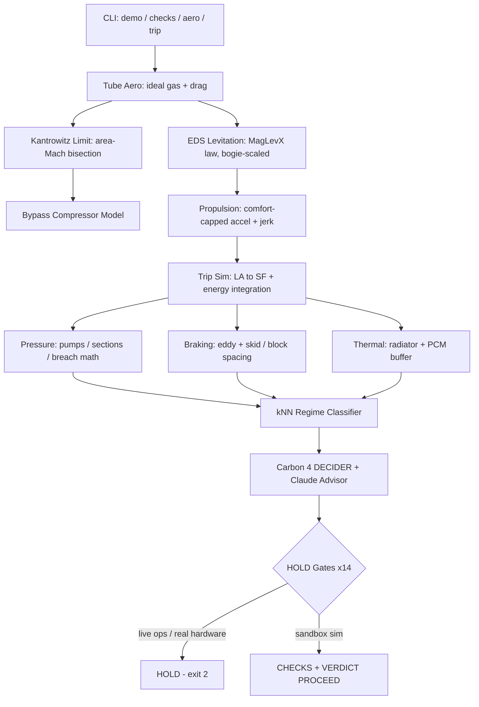
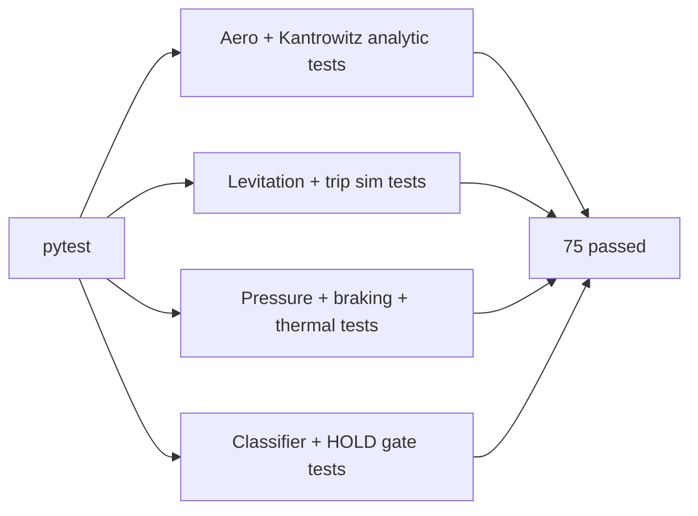
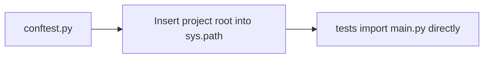
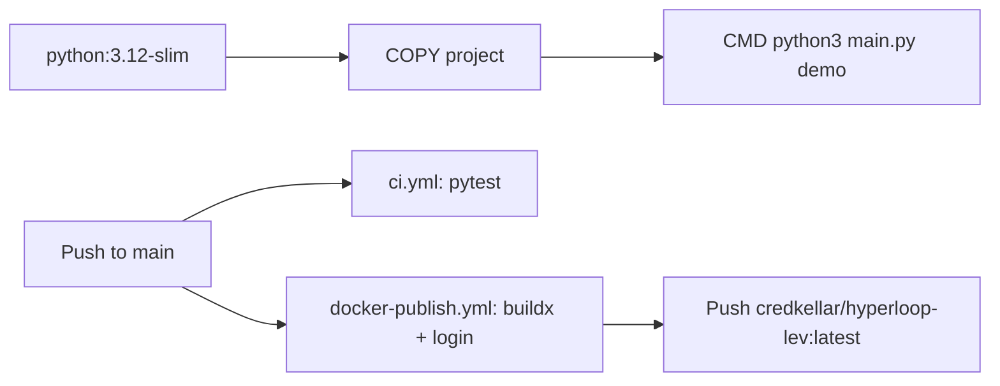

# Hyperloop-Lev 🚄🌀

**Evacuated Tube Levitation Transport Lab** — by Darion Kellar

Hyperloop-Lev is an **educational evacuated-tube transport lab** in ONE pure-Python file. It is the direct evolution of **MagLevX**, and the difference is one word — **the tube**:

- **MagLevX** = EDS maglev on an **open guideway**: at 430 km/h the air is still thin enough to push through, and aerodynamics is a tax you pay. 🚄
- **Hyperloop-Lev** = the same EDS levitation and linear-motor ideas moved **inside a low-pressure tube** (~100 Pa): the air is pumped out until drag nearly vanishes, and the pod runs at a **1,200 km/h design target** — where a whole new set of physics problems (choking, heat, pressure safety) shows up to replace the drag. 🌀

The lab builds that trade honestly, with real formulas: ideal-gas tube aerodynamics, the **Kantrowitz choking limit** and the bypass compressor it forces, EDS levitation **carried over from MagLevX** (same law, same constants, scaled by bogies), a jerk-limited LA → San Francisco trip simulation with comfort-capped acceleration, tube pressure systems with bulkhead isolation and breach safety math, emergency braking, near-vacuum thermal rejection, and a from-scratch kNN regime classifier. 🔬

Honest scope, stated up front: 1,200 km/h is a **labelled design target, not a claim** — no pod, tube, or passenger service exists here. This lab operates **nothing real**: no hardware, no vacuum plant, no passengers. Every live / product claim sits behind a permanent HOLD gate (14 total). 🔒

[](https://github.com/kimanicollier44-cmyk/Hyperloop-Lev/actions/workflows/ci.yml)
[](https://github.com/kimanicollier44-cmyk/Hyperloop-Lev/actions/workflows/docker-publish.yml)

> ℹ️ These are the **live** workflow badges for this repo. They activate as soon as the `ci.yml` and `docker-publish.yml` files from the paste pack are pasted into `.github/workflows/` — until then they have nothing to report yet.

## 🧰 Tech Stack Badges & Full Architecture Tech Stack

### 💻 Core Programming Languages & Core Systems


- 🐍 Python 3.12, pure standard library (`math`, `hashlib`, `json`, `sys`) — zero dependencies, zero network, deterministic (double-run byte-identical)
- 🌡️ Tube physics core: ideal-gas density `ρ = P/(R·T)`, drag `½ρCdAv²`, the isentropic area–Mach relation behind the Kantrowitz limit, choked-orifice breach flow, Stefan–Boltzmann radiation — every formula asserted against its analytic value in CHECKS
- 🧲 Levitation: the EDS force law and constants from MagLevX (`K`, `V0`, gap, magnetic-drag shape), scaled by bogie count 4/16 for the pod
- 🧠 TinyML kNN regime classifier (from scratch, stdlib): feasible / marginal / infeasible from distance + pressure + blockage
- 🪑 Council seats: Gemini Carbon 4 DECIDER (names-only, tighten-only) + Muse advisor (never overrides HOLD) + Google Flow plan-only (rendered = False, live = 0)

### ⛓️ Web3 & Infrastructure

- 🚫 **Not applicable — honestly.** No blockchain, no Web3, no tokens: the "infrastructure" in this lab is a labelled simulation of a tube, its pumps, and its bulkhead sections inside one offline file. No fake badges here.

### ⚙️ Platform Support & Hardware Architecture


- 🖥️ Pure Python — runs anywhere Python 3.12+ runs (Linux, macOS, Windows), plus the `python:3.12-slim` Docker image
- 🔒 No hardware is controlled, ever: real pods, vacuum pumps, linear motors, and tube plant are permanent HOLD gates (see the gate table below)

### ⚡ Low-Level Infrastructure & Performance

- 🚫 **No low-level code — honestly.** No C, no C++, no GPU, no compiled extensions: this is one interpreted Python file on purpose, so every number can be read, checked, and diffed. Performance here means honest algorithms — bisection solvers for the Kantrowitz Mach and EDS liftoff, a fixed-step jerk-limited integrator for the trip — all deterministic and byte-identical between runs.

### 🛠️ DevOps & Build Tools


- 🐳 Docker (`python:3.12-slim`), GitHub Actions CI + Docker Publish (delivered in the paste pack)
- 🎯 Target image: `credkellar/hyperloop-lev:latest`
- 🧪 Tests: `pytest` (75 tests) + the built-in CHECKS suite (72 checks) in `main.py`

### ☁️ Cloud Providers

- 🚫 **None — honestly.** No cloud provider is used or needed: the lab runs fully offline on your own machine or in a local Docker container. Docker Hub appears only as the registry the publish workflow pushes the image to.

## What this does?

1. 🌬️ **Tube aerodynamics — why the tube exists** — air density from the ideal-gas law: 1.2041 kg/m³ at 1 atm falls to 0.001188 kg/m³ at the 100 Pa design pressure, a factor of exactly **1,013.25** (the pressure ratio). Drag falls with it: at the 1,200 km/h design cruise the pod fights **59.7 N** of drag in the tube — versus **60,526 N** (20,175 kW!) in open air.
2. 🚧 **Kantrowitz limit** — the pod blocks 0.36 of the tube, so the air ahead of it must squeeze through the annulus. Solving the isentropic area–Mach relation `A/A*(M) = 1/(1 − β)` gives a choking limit of **Mach 0.4088 ≈ 505 km/h**: faster than that, the annulus chokes. The limit is computed by bisection and asserted in CHECKS — not quoted from a brochure.
3. 🌀 **Compressor bypass (labelled concept model)** — above the Kantrowitz speed, a nose compressor swallows the bow air (`ṁ = ρ·v·A` = 1.792 kg/s at cruise) and ejects it behind the pod; the isentropic shaft-power model prices it at **40.3 kW**. It is the labelled mechanism that lets the design target exceed the choking limit.
4. 🧲 **Levitation, carried over from MagLevX** — the same EDS law `F = K·(1 − e^(−v/V0))·(gap_ref/gap)` with the same constants, scaled by bogies (pod 4 vs trainset 16, so `K` = 1.625 × 10⁶ N). Lift is **zero at standstill** — the pod sits on skids until liftoff at **13.7 km/h** — and the magnetic-drag tax peaks at 30 m/s (levitation power 140.0 kW) before falling to 5.68 kW at cruise.
5. 🚀 **Propulsion with a comfort cap** — linear-motor thrust against tube drag + magnetic drag, service acceleration capped at **0.8 m/s²** and jerk at 0.5 m/s³; the sim records its peak at **0.0816 g**, inside the 0.10 g comfort ceiling the checks enforce. 1,200 km/h is always printed as what it is: a **design target**.
6. 🗺️ **Trip sim: Los Angeles → San Francisco (560 km)** — analytic phases (accel 69.44 km / 416.7 s, cruise 421.11 km / 1,263.3 s, decel 416.7 s) plus a jerk-limited simulation with per-step energy integration: **35.08 min** station to station, **178.5 kWh** per trip, **0.0114 kWh/passenger-km** (model) — against a labelled ~85 min flight *block time alone*. Short routes get the honest triangular profile instead (a 50 km hop peaks at 720 km/h and never reaches cruise).
7. 🎈 **Pressure systems** — the whole 560 km tube at 100 Pa holds just **8,363 kg** of air (vs 8,473,582 kg at 1 atm); pumps hold pressure against a labelled leak load for **23.07 kW**. Bulkhead doors split the route into **23 sections of 25 km** so a breach fills one section, not the line.
8. 🛟 **Leak safety math (sim only)** — a labelled 0.01 m² breach admits choked flow at 1.913 kg/s and repressurises one section to 10 kPa in **5.37 h**; the pod's labelled breathing reserve lasts **25.51 h** — a **4.75× margin**, computed, not asserted. (Live venting and pressure interlocks are HOLD gates, permanently.)
9. 🛑 **Emergency braking + block spacing** — from 1,200 km/h: service braking (0.8 m/s²) stops in 69,444 m, the eddy brake (1.0 m/s²) in **55,556 m**, the friction-skid last resort (0.3 m/s²) in 185,185 m. The 231.5 kWh of kinetic energy splits into 150.5 kWh regenerated and 81.0 kWh of eddy heat. Block spacing = eddy stop + reaction margin + pod length = **58.91 km → 20.4 pods/hour/direction**.
10. 🌡️ **Thermal in near-vacuum** — at 100 Pa there is no convection to speak of, so the pod cools like a spacecraft: a labelled 10.0 kW heat load (passengers, avionics, compressor waste heat) is rejected by a 320 K radiator at **158.2 W/m²**, needing **63.2 m²** of the pod's 188.5 m² skin — plus a 90 kg phase-change buffer for 30 radiator-free minutes.
11. 🏷️ **Regime classifier + seats + checks** — a from-scratch kNN labels design points feasible / marginal / infeasible (LA–SF design: feasible; a 300 km / 500 Pa regional: marginal; cross-country in open air or a 0.65-blockage pod: infeasible), with Carbon 4 DECIDER (sha256 trace), Muse advisor, Google Flow plan-only, and a built-in CHECKS suite (72 checks).

## 🗺️ How it works — diagram per script

### `main.py` — the whole lab



### `tests/test_main.py` — verification



### `conftest.py` — test path setup



### `Dockerfile` + CI flow — container & publish



## Why is this cool?

1. 🌬️ The tube is a **drag-delete with a receipt**: one ideal-gas line turns 20,175 kW of open-air drag power into 19.91 kW — the entire hyperloop idea in a single ratio, 1,013.25×.
2. 🚧 The Kantrowitz limit is **solved, not quoted**: the lab bisects the isentropic area–Mach relation and shows exactly where the annulus chokes (Mach 0.4088) for this pod in this tube.
3. 🌀 The bypass compressor is priced like an engineer would: mass flow in, isentropic work out — 40.3 kW to break the choking limit, labelled as the concept model it is.
4. 🧲 It **inherits honestly**: the EDS levitation is MagLevX's own law and constants with the bogie scaling stated in the open, so the two labs can be cross-checked against each other.
5. 🎢 Comfort is enforced in code, not promised in prose: acceleration is clamped, jerk is limited, and the sim's measured peak (0.0816 g) is asserted against the ceiling in CHECKS.
6. 🗺️ LA → San Francisco in **35.08 sim minutes** with the energy integrated step by step — 0.0114 kWh/passenger-km next to the labelled flight and MagLevX references, each marked as the estimate it is.
7. 🛟 The safety story is arithmetic: one breached section, 5.37 h to fill, 25.51 h of breathing reserve — a 4.75× margin you can recompute, not a vibe.
8. 🛑 Braking is layered and priced: regenerative service braking, an eddy emergency layer, a friction-skid last resort, and a block-spacing rule derived from the worst honest stop.
9. 🌡️ The thermal section teaches the sneakiest problem in the whole concept: in near-vacuum you cool like a spacecraft, and the radiator math (63.2 m² of skin) decides whether the pod cooks.
10. 🎯 Deterministic end to end: run it twice, get byte-identical output — a hyperloop you can diff.

## What problems this solves?

1. ❌ **Problem:** Hyperloop explainers wave at "low pressure = low drag" without numbers. ✅ **Solution:** The ideal-gas density and drag are computed at both pressures; the 1,013.25× ratio *is* the explanation.
2. ❌ **Problem:** The Kantrowitz limit is usually mentioned as trivia, if at all. ✅ **Solution:** It is derived from the area–Mach relation for the actual blockage (0.36) and checked against the cruise Mach in the test suite.
3. ❌ **Problem:** "1,200 km/h" gets marketed as a specification. ✅ **Solution:** Every appearance is labelled DESIGN TARGET, the comfort cap is enforced in the sim, and `commercial_service_claim` / `claim_certified_system` are permanent HOLD gates.
4. ❌ **Problem:** Levitation in a tube gets hand-waved as "same as maglev". ✅ **Solution:** The carry-over is explicit — same law, same constants, one stated scaling factor — and the differences (liftoff at 13.7 km/h for the lighter pod) fall out of the math.
5. ❌ **Problem:** Trip-time claims ignore acceleration entirely. ✅ **Solution:** Analytic phases plus a jerk-limited sim: 139 km of the 560 km route is spent speeding up or slowing down, and the timetable shows it.
6. ❌ **Problem:** Tube safety is discussed as if the whole line were one volume. ✅ **Solution:** Bulkhead sectioning is in the model — a breach fills 25 km, and the reserve-vs-fill margin is computed.
7. ❌ **Problem:** Pumping costs are invisible in concept art. ✅ **Solution:** The labelled leak load is priced in kW (23.07 kW route-wide) with the logarithmic compression formula shown.
8. ❌ **Problem:** Emergency stopping at 1,200 km/h is rarely quantified. ✅ **Solution:** Three braking layers, three stopping distances, the kinetic-energy split, and the block spacing they force.
9. ❌ **Problem:** Cooling is forgotten until the pod is a oven with windows. ✅ **Solution:** Stefan–Boltzmann radiator sizing and a phase-change buffer mass are first-class outputs.
10. ❌ **Problem:** Simulation tools quietly imply a service is next. ✅ **Solution:** 14 named HOLD gates return exit code 2 for every live-operation, construction, investment, or regulatory claim, forever.

## How to install this?

1. 📋 Clone or download this project folder.
2. 🐍 Make sure Python 3.12+ is installed: `python3 --version`
3. ▶️ Run the full demo + checks (no arguments needed):

```bash
python3 main.py
```

4. 🧪 Run the test suite:

```bash
pip install pytest
python3 -m pytest -q
```

5. 🎛️ Try the other commands:

```bash
python3 main.py checks      # 72 built-in checks
python3 main.py aero        # tube aero + Kantrowitz + bypass report
python3 main.py levitation  # EDS carry-over from MagLevX
python3 main.py trip        # LA -> SF phases, trip sim, energy comparison
python3 main.py pressure    # pumps, sections, breach + breathing reserve
python3 main.py braking     # braking layers + block spacing
python3 main.py thermal     # radiator + phase-change buffer sizing
python3 main.py classify    # kNN regime classifier report
python3 main.py brains      # Carbon 4 + Muse + Flow seats
python3 main.py holds       # list all 14 HOLD gates
python3 main.py hold-demo   # exits 2 - gated actions stay HOLD
```

6. 🐳 Or run it in Docker:

```bash
docker build -t credkellar/hyperloop-lev:latest .
docker run --rm credkellar/hyperloop-lev:latest
```

## Requirements

- 🐍 Python 3.12 or newer
- 📦 Dependencies: **none** (standard library only)
- 🌐 Network: **none** — fully offline
- 🧪 For tests only: `pytest`
- 🐳 Optional: Docker

## FULL project structure tree

```text
hyperloop-lev/
├── main.py                  # the whole lab: tube aero, Kantrowitz, bypass, EDS levitation, trip sim, pressure, braking, thermal, classifier, seats, HOLD gates
├── conftest.py              # puts the project root on sys.path for tests
├── tests/
│   └── test_main.py         # 75 pytest tests: aero, Kantrowitz, levitation, trip, pressure, braking, thermal, gates, determinism
├── assets/
│   └── cover.png            # README cover image (2736 x 912)
├── Dockerfile               # python:3.12-slim, runs the demo
├── .gitignore               # __pycache__/, .pytest_cache/, *.pyc
└── README.md                # this file
```

> 📦 Delivered separately as paste packs (not in this tree): `.github/workflows/ci.yml` + `docker-publish.yml`, and the Docker Hub pack (100-char description, 350-char About, overview, categories).

## 🔒 HOLD gates — all 14, permanent

| # | Gate | What stays held |
|---|------|-----------------|
| 1 | `live_passenger_operation` | No live passenger operation, ever; nobody rides a simulation |
| 2 | `real_hardware_control` | No control of real pods, pumps, motors, or tube hardware |
| 3 | `bypass_pressure_interlocks` | Pressure interlocks and bulkhead isolation are never bypassed |
| 4 | `disable_emergency_venting` | Emergency venting / repressurisation paths are never disabled |
| 5 | `claim_certified_system` | No claim this simulation is a certified transport system |
| 6 | `commercial_service_claim` | No commercial service claims from a lab model |
| 7 | `vacuum_operation_live` | No live vacuum / low-pressure tube operation directed from a sim |
| 8 | `exceed_test_limits_live` | Test-envelope limits are never exceeded on live hardware |
| 9 | `remove_human_override` | The human override is never removed |
| 10 | `cargo_hazmat_live` | No live hazmat cargo planning on a passenger pod model |
| 11 | `medical_claim` | No medical transport or life-support claims beyond labelled sim math |
| 12 | `investment_claim` | No investment claims; a lab model is not a prospectus |
| 13 | `construction_claim` | No construction guidance for real tubes, tunnels, or pylons |
| 14 | `regulatory_approval_claim` | No claim of regulatory approval or pending certification |

🧑‍⚖️ **Council seats:** Gemini Carbon 4 Extended Thinking — DECIDER (names-only, tighten-only, MAP → MODEL → STRESS → DECIDE, sha256 trace, `can_override_hold = False`) · Muse — advisor (`can_override_hold = False`) · Google Flow — plan-only (`rendered = False`, `live = 0`).

✅ **Verification:** pytest **75 passed** (project + clean copy) · built-in CHECKS **72/72** · double-run output **byte-identical** · `hold-demo` exits **2** · `main.py` **1,062 lines**, pure stdlib, zero network.

## 🧒 5th-grade English section

Imagine a train that floats on magnets — no wheels touching anything. Now put that train inside a **giant straw** and suck almost all the air out of the straw. 🌬️

- Air is what slows fast things down. Push your hand out of a car window and you feel it push back! With almost no air in the tube, almost nothing pushes back on the pod, so it can go **super fast** — this lab aims at 1,200 km/h, about ten times faster than a car on the highway. 🚀
- But there is a catch: the pod is fat and the tube is narrow, so the little air left in front gets **squished**. If the pod goes too fast, the squished air gets stuck like a clog in a drain. Scientists call that the **Kantrowitz limit**. This lab does the math to find exactly where the clog starts, and gives the pod a nose fan that swallows the air and spits it out the back. 🌀
- The floating magnets are borrowed from the MagLevX train lab — the same math, just sized for a smaller pod. The pod needs little skids to sit on until it moves fast enough to float. 🧲
- If a hole ever let air leak into one piece of the tube, doors inside the tube keep the leak in just that one piece. The pod carries extra breathing air that lasts **much longer** than the leak takes to fill its piece — the lab checks that with numbers, like a fire drill you do with math. 🛟
- Up in the near-empty tube there is no breeze to cool the pod, so it glows its heat away like the night side of a spaceship, and carries a special wax that melts slowly to soak up extra heat. 🌡️
- This project is a **pretend lab on a computer**. It does not build a real tube or carry real people. It helps you learn why sucking the air out of a tube is both a brilliant idea and a really hard one. 💻

---

MIT © 2026 Darion Kellar · Hyperloop-Lev — educational simulation only 🚄
